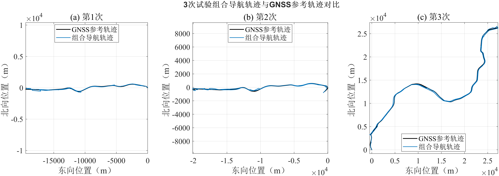
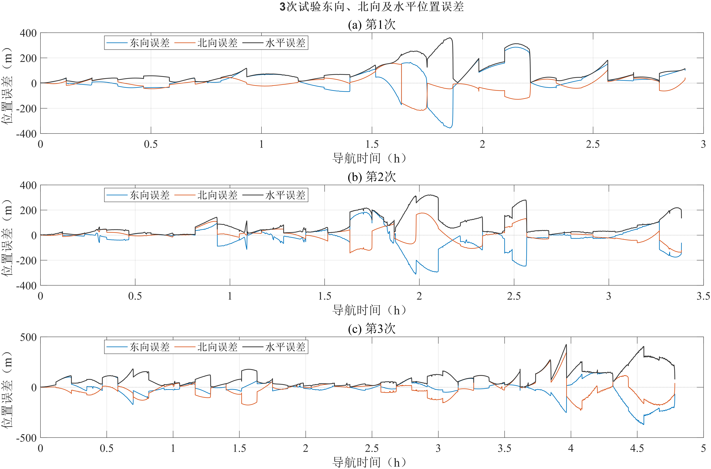

## a) 试验完成情况

本次采用车载实测数据驱动的半物理实时化试验方式，共开展3次组合导航测试。试验过程中，将车载实测惯性数据及基于GNSS参考轨迹生成的模拟声学距离数据，按照规定的数据格式和时序输入工程样机，由被试设备完成惯性导航递推、模拟声学距离量测更新及组合导航解算，并记录导航输出及相关运行状态。

各次试验的有效导航时长、模拟声学距离更新情况及导航输出情况见表1。

表1 组合导航实时化试验完成情况

| 测试项目 | 第1次 | 第2次 | 第3次 |
| --- | ---: | ---: | ---: |
| 有效导航时长（s） | 10500.00 | 12180.00 | 17220.00 |
| 惯性数据输入频率（Hz） | 100.00 | 100.00 | 100.00 |
| 模拟声学测距周期（s） | 420.00 | 420.00 | 420.00 |
| 模拟距离观测次数 | 25 | 29 | 41 |
| 有效距离更新次数 | 25 | 29 | 41 |
| 导航输出频率（Hz） | 100.00 | 100.00 | 100.00 |
| 导航输出异常次数 | 0 | 0 | 0 |

根据试验记录，3次测试的导航数据输入、模拟声学距离接收及导航结果输出均连续完成；评价时段内模拟声学距离记录全部满足格式、时序和正距离检查并进入组合导航解算，导航输出未检出非有限值、时间倒序或异常时间间隔。试验期间记录的设备运行状态及相关数据，可用于后续导航精度统计与分析。

## b) 导航轨迹测试结果

以车载GNSS参考轨迹作为位置评价基准，将3次试验中被试设备输出的组合导航轨迹与对应GNSS参考轨迹进行对比，结果如图1所示。

其中，图1(a)、图1(b)和图1(c)分别对应第1次、第2次和第3次导航试验。

根据轨迹对比结果，3次试验中组合导航轨迹均与GNSS参考轨迹保持时间对应和整体走向一致，但在有效导航时段内存在不同程度的水平偏离；各航次偏离程度由图2及表2中的误差统计量定量表征。该结果反映了工程样机在420 s稀疏模拟声学距离辅助条件下的二次RTS导航轨迹输出情况。

## c) 水平定位精度测试结果

根据3次试验中被试设备输出的组合导航位置及GNSS参考位置，采用统一的时间匹配和WGS-84局部曲率转换方法，分别计算各试验的东向、北向及水平位置误差。

3次试验的位置误差随导航时间变化情况如图2所示。

其中，图2(a)、图2(b)和图2(c)分别对应第1次、第2次和第3次导航试验。

对各次试验严格二次RTS有效时段内的位置误差进行统计，每段结果均截止于对应测距节点，得到东向、北向及水平位置RMSE，结果见表2。

表2 组合导航水平定位精度测试结果

| 精度评价指标 | 第1次 | 第2次 | 第3次 |
| --- | ---: | ---: | ---: |
| 东向位置RMSE（m） | 100.90 | 92.53 | 92.95 |
| 北向位置RMSE（m） | 62.00 | 57.25 | 85.12 |
| 水平位置RMSE（m） | 118.43 | 108.81 | 126.04 |
| 最大水平位置误差（m） | 359.86 | 323.59 | 424.32 |

在3次试验采用一致的数据处理方法及各自严格二次RTS有效时段的条件下，将全部有效历元合并，并按均方误差定义计算得到综合水平位置RMSE为119.00 m。

其中，第1次、第2次和第3次试验的水平位置RMSE分别为118.43 m、108.81 m和126.04 m。3次试验的水平定位误差变化情况及精度差异详见图2和表2。

## d) 综合测试结果

本次完成3次基于车载实测数据的半物理实时化组合导航试验，获取了工程样机在规定模拟声学距离辅助条件下的导航输出结果及水平定位精度数据。

根据测试记录和精度统计结果，工程样机的组合导航解算、模拟声学距离量测更新及导航信息输出均连续完成；评价时段内模拟声学距离记录全部满足格式、时序和正距离检查并进入组合导航解算，导航输出未检出非有限值、时间倒序或异常时间间隔，3次试验的综合水平位置RMSE为119.00 m。

本次测试采用基于GNSS参考轨迹生成的模拟声学距离观测，测试结果反映了工程样机在规定半物理试验条件下的组合导航定位性能。是否满足本阶段水平定位精度要求，按照产品技术条件及本阶段适用的测试评价准则进行判定。

> 统计口径：组合导航结果采用严格二次RTS输出，每段结果截止于对应测距节点，末尾仅完成一次RTS的区间不纳入评价；综合RMSE按3个航次全部有效历元合并计算。有效距离更新次数表示进入解算时序且通过格式、有限值和正距离检查的距离记录数。
